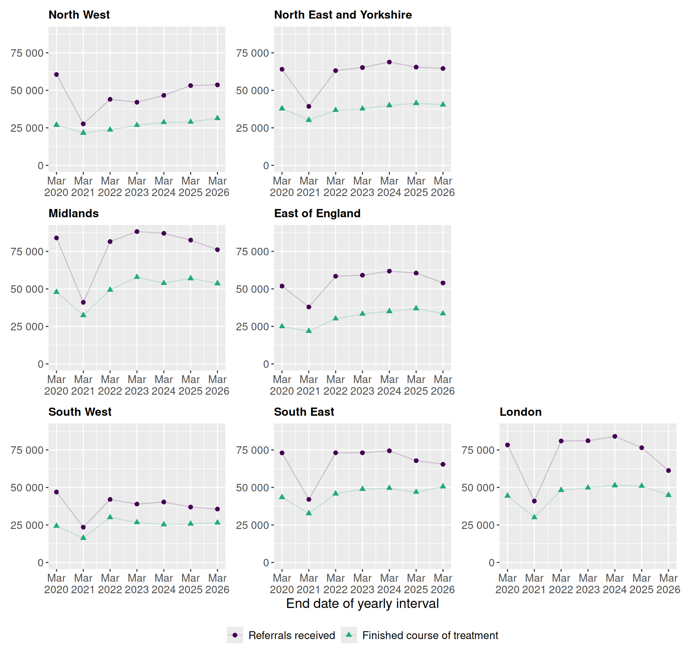

# Referrals and finished treatments

> **Note:** This guide is for illustration purposes only and may contain
> errors. It demonstrates example usage of the dataset and functions,
> but results should not be interpreted as validated analyses.

This example demonstrates how to explore annual NHS Talking Therapies
reports using the `nhstt` package. We’ll look at regional trends in
depression referrals and finished treatments to illustrate the basic
workflow for accessing and visualising this publicly available data.

## Setup

We start by loading the necessary packages and downloading the annual
key measures dataset with
[`get_measures_annual()`](https://bennettoxford.github.io/nhstt/reference/get_measures_annual.md).
This report contains annual performance indicators for NHS Talking
Therapies services across England.

``` r

# Load packages
library(nhstt)
library(ggplot2)
library(dplyr)
library(scales)
library(stringr)
library(patchwork)

# Measures to analyse, with labels for the figure
selected_measure_labels <- c(
  referrals_received = "Referrals received",
  finished_course_treatment = "Finished course of treatment"
)

# Filters for data selection
selected_org_type <- "Commissioning Region"
excluded_org_name <- "UNKNOWN"
selected_measure_statistic <- "count"
selected_variable_a <- "Depression"

# Get measures_annual data
measures_annual <- get_measures_annual(
  periods = c(
    "2019-20",
    "2020-21",
    "2021-22",
    "2022-23",
    "2023-24",
    "2024-25",
    "2025-26"
  )
)
```

## Select data for analysis

Here we filter the data to focus on received referrals and finished
treatments at the regional level. This step requires careful exploration
of the underlying data structure.

``` r

# Select data for analysis
selected_measures <- measures_annual |>
  filter(org_type == selected_org_type) |>
  filter(org_name != excluded_org_name) |>
  filter(measure_name %in% names(selected_measure_labels)) |>
  filter(measure_statistic == selected_measure_statistic) |>
  filter(variable_a == selected_variable_a) |>
  select(
    start_date,
    end_date,
    org_name,
    variable_a,
    measure_statistic,
    measure_name,
    value
  )

# Tidy data for analysis
selected_measures <- selected_measures |>
  mutate(
    org_name = str_to_title(str_remove(org_name, "\\s*COMMISSIONING REGION$")),
    org_name = str_replace_all(org_name, "\\b(Of|And)\\b", tolower),
    measure_name = factor(
      measure_name,
      levels = names(selected_measure_labels),
      labels = selected_measure_labels
    )
  )
```

## Create figure

Finally, we visualise the trends over time for each region.



Figure 1: Trends for counts of referrals received and finished course of
treatment for depression broken down by region.
