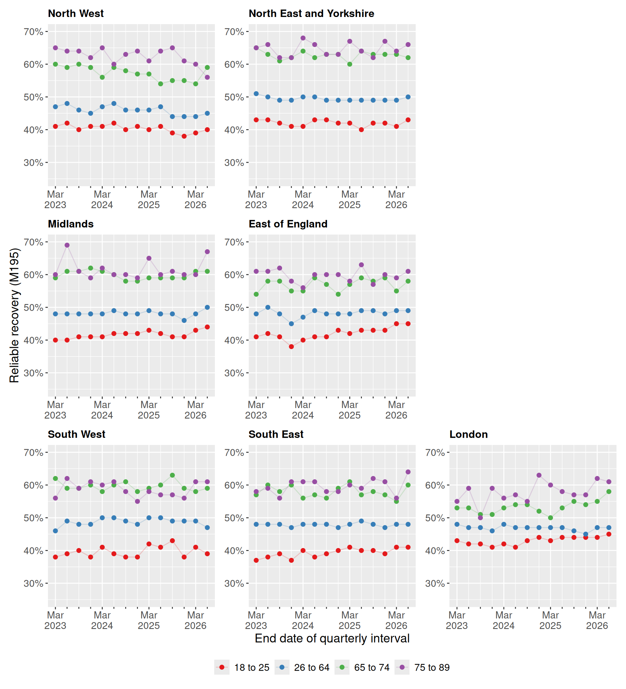

# Reliable recovery by age group

> **Note:** This guide is for illustration purposes only and may contain
> errors. It demonstrates example usage of the dataset and functions,
> but results should not be interpreted as validated analyses.

This example shows how to explore quarterly NHS Talking Therapies
reports with the `nhstt` package. The quarterly data uses the same
measure IDs as the monthly data, such as M195 for reliable recovery. It
also adds demographic and clinical breakdowns, such as age group,
ethnicity and religion. The [quarterly
metadata](https://bennettoxford.github.io/nhstt/articles/metadata-quarterly.html)
lists all measures and breakdowns.

Here we look at reliable recovery by age group in each NHS England
commissioning region.

## Setup and data selection

We load the R packages and the quarterly measures with
[`get_measures_quarterly()`](https://bennettoxford.github.io/nhstt/reference/get_measures_quarterly.md).
We also set the region and age group filters we use later.

``` r

# Load packages
library(nhstt)
library(ggplot2)
library(dplyr)
library(tidyr)
library(scales)
library(stringr)
library(patchwork)
library(gt)

# All age groups, in display order
all_age_groups <- c(
  "Under 18",
  "18 to 25",
  "26 to 64",
  "65 to 74",
  "75 to 89",
  "90 and over"
)

# Filters for data selection
selected_org_type <- "CommissioningRegion"
excluded_org_name <- "Unknown"
selected_measure_id <- "M195"
selected_variable_type <- "Age Group"

# Get measures_quarterly data
measures_quarterly <- get_measures_quarterly()
```

Show data selection code

``` r

# Plot only the four age groups with the most referrals that finished a course
# of treatment (M076) in England, as regional counts for the others are small
top_age_groups <- measures_quarterly |>
  filter(org_type == "England") |>
  filter(measure_id == "M076") |>
  filter(variable_type == selected_variable_type) |>
  filter(variable_a %in% all_age_groups) |>
  count(variable_a, wt = value, sort = TRUE) |>
  slice_head(n = 4) |>
  pull(variable_a)

# Keep the age groups in age order
selected_age_groups <- intersect(all_age_groups, top_age_groups)

selected_age_groups
#> [1] "18 to 25" "26 to 64" "65 to 74" "75 to 89"

# Select data for analysis
selected_age <- measures_quarterly |>
  filter(org_type == selected_org_type) |>
  filter(icb_name != excluded_org_name) |>
  filter(measure_id == selected_measure_id) |>
  filter(variable_type == selected_variable_type) |>
  filter(variable_a %in% selected_age_groups) |>
  select(end_date, org_name = icb_name, age_group = variable_a, value)

# Tidy data for analysis
selected_age <- selected_age |>
  mutate(
    age_group = factor(age_group, levels = selected_age_groups),
    org_name = str_remove(org_name, "\\s*COMMISSIONING REGION$"),
    org_name = str_to_title(org_name),
    org_name = str_replace_all(org_name, "\\b(Of|And)\\b", tolower)
  )
```

## Results

### England in the first and last quarter

[Table 1](#tbl-england) shows how many referrals reliably recovered
(M193) and the percentage that reliably recovered (M195) in England. It
covers every age group in the first and last quarter of the data.

Show table code

``` r

# Reporting periods sort correctly as text, for example "2022-23-q2"
first_period <- min(measures_quarterly$reporting_period)
last_period <- max(measures_quarterly$reporting_period)

# Spell out the quarter in column headers, for example "2022-23 Quarter 2"
label_period <- function(period) {
  str_replace(period, "-q(\\d)$", " Quarter \\1")
}

# Rows of the table, in display order
table_groups <- bind_rows(
  tibble(
    breakdown = "Total",
    variable_type = "Total",
    variable_a = "Total"
  ),
  tibble(
    breakdown = "Age group",
    variable_type = selected_variable_type,
    variable_a = c(all_age_groups, "Not stated/Not known/Invalid")
  )
)

table_values <- measures_quarterly |>
  filter(org_type == "England") |>
  filter(measure_id %in% c("M193", "M195")) |>
  filter(reporting_period %in% c(first_period, last_period)) |>
  mutate(reporting_period = label_period(reporting_period)) |>
  select(variable_type, variable_a, reporting_period, measure_id, value)

table_data <- table_groups |>
  left_join(table_values, by = c("variable_type", "variable_a")) |>
  mutate(
    group = case_match(
      variable_a,
      "Total" ~ "England",
      "Not stated/Not known/Invalid" ~ "Unknown",
      .default = variable_a
    )
  ) |>
  select(-variable_type, -variable_a) |>
  pivot_wider(
    names_from = c(reporting_period, measure_id),
    values_from = value,
    names_sort = TRUE
  )
#> Warning: There was 1 warning in `mutate()`.
#> ℹ In argument: `group = case_match(...)`.
#> Caused by warning:
#> ! `case_match()` was deprecated in dplyr 1.2.0.
#> ℹ Please use `recode_values()` instead.

table_data |>
  gt(groupname_col = "breakdown", rowname_col = "group") |>
  tab_stub_indent(rows = everything()) |>
  tab_spanner_delim(delim = "_") |>
  cols_label(
    ends_with("M193") ~ "Count",
    ends_with("M195") ~ "%"
  ) |>
  fmt_integer(columns = ends_with("M193")) |>
  fmt_number(columns = ends_with("M195"), decimals = 1) |>
  tab_style(
    style = cell_text(weight = "bold"),
    locations = list(cells_row_groups(), cells_column_spanners())
  )
```

[TABLE]

Table 1: Count (M193) and percentage (M195) of referrals that reliably
recovered in England, by age group, for the first and last quarter in
the data.

### Trends and variation by region and age groups

[Figure 1](#fig-age) shows reliable recovery over time in each region.
It only shows the four largest age groups for clarity.

Show figure code

``` r

# Arrange regions roughly as they sit on a map of England
region_order <- c(
  "North West",
  "North East and Yorkshire",
  "Midlands",
  "East of England",
  "South West",
  "South East",
  "London"
)

region_layout <- "
AB#
CD#
EFG
"

# Use the same y-axis range in all panels so regions are easy to compare
value_limits <- c(25, 70)

# Label the end of each financial year to keep the axis readable
year_end_breaks <- selected_age |>
  filter(format(end_date, "%m") == "03") |>
  distinct(end_date) |>
  pull(end_date)

fig_reliable_recovery_by_region <- region_order |>
  lapply(\(region) {
    selected_age |>
      filter(org_name == region) |>
      ggplot(aes(x = end_date, y = value, colour = age_group)) +
      geom_line(alpha = 0.2) +
      geom_point(size = 2) +
      labs(
        title = region,
        x = "End date of quarterly interval",
        y = "Reliable recovery (M195)",
        colour = NULL
      ) +
      scale_x_date(
        breaks = year_end_breaks,
        minor_breaks = unique(selected_age$end_date),
        labels = label_date("%b\n%Y")
      ) +
      # Tick every quarter, label only the end of each financial year
      guides(x = guide_axis(minor.ticks = TRUE)) +
      scale_y_continuous(
        labels = label_percent(scale = 1),
        limits = value_limits
      ) +
      scale_colour_brewer(palette = "Set1")
  }) |>
  wrap_plots(
    design = region_layout,
    guides = "collect",
    axis_titles = "collect"
  ) &
  theme(
    legend.position = "bottom",
    text = element_text(size = 14),
    plot.title = element_text(size = 12, face = "bold")
  )

fig_reliable_recovery_by_region
```



Figure 1: Percentage of referrals that reliably recovered (M195) over
time for the four largest age groups, by region.
