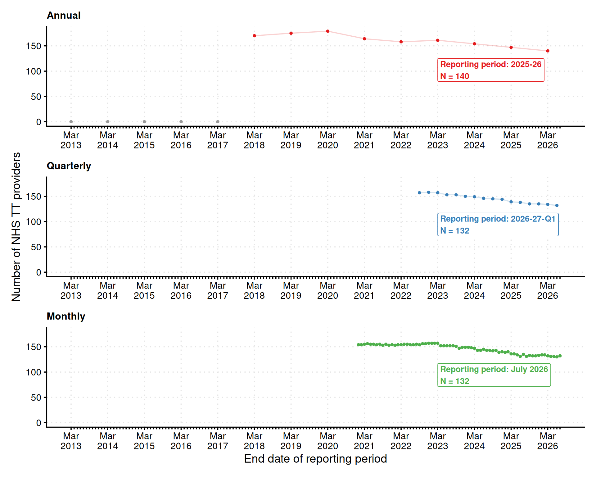

# Submission history for NHS TT providers

> **Note:** The counts reflect the data we have added to the package so
> far and may differ from the full reports published by NHS England. For
> example, before 2017-18 the annual reports used a substantially
> different data format. We have not yet added provider level breakdowns
> for these years, only totals for England.

This page shows how many NHS Talking Therapies providers submitted data
in each reporting period of the annual, quarterly, and monthly datasets.

Figure 1: Trends of providers that submitted data in each reporting
period. The labels show the total number of providers that submitted
data in the latests available reporting period. The grey points at zero
in the annual panel indicate the years where we have not yet added
provider level breakdowns.
